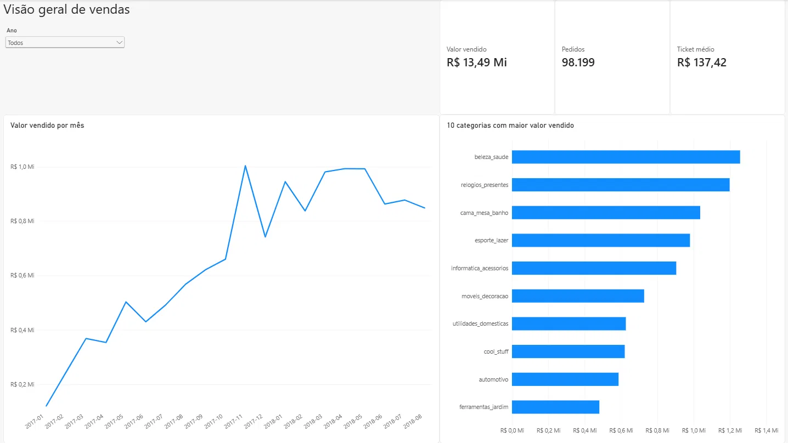
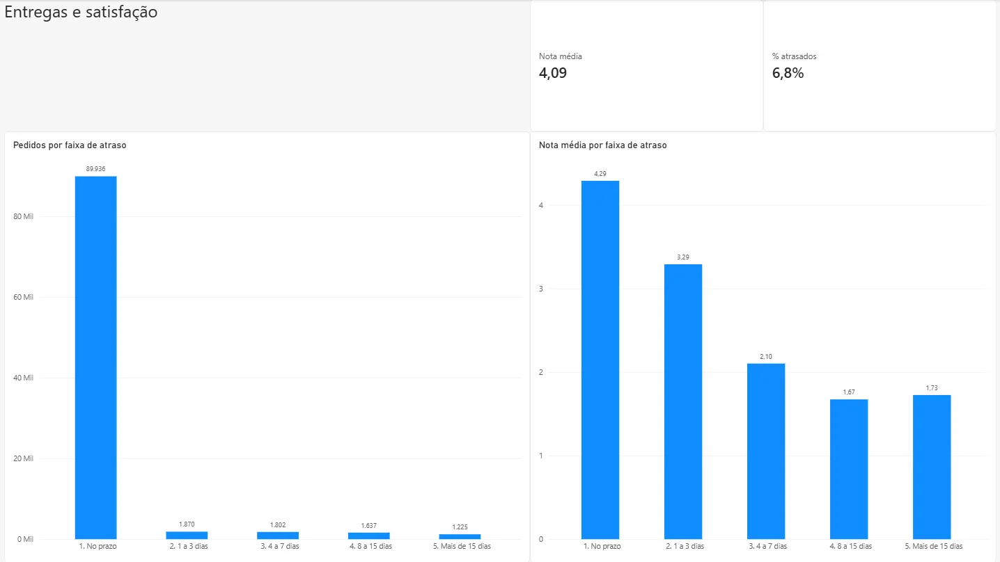
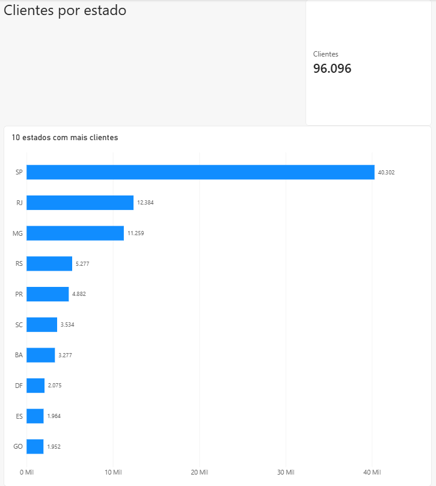

# Dashboard de vendas e entregas da Olist

Dashboard em Power BI feito com os dados públicos da Olist, um marketplace brasileiro, de setembro de 2016 a outubro de 2018. Ele usa as mesmas regras de cálculo da [análise em Python](https://github.com/paulorcmj/analise-vendas-olist) que fiz com esses dados, e os resultados batem, com pequenas diferenças explicadas mais abaixo.

O arquivo é o `dashboard_vendas_olist.pbix`, para abrir no Power BI Desktop, e há também uma versão em PDF, `dashboard_vendas_olist.pdf`.

## Páginas

### Visão geral de vendas

Valor vendido (R$ 13,49 milhões), número de pedidos (98.199) e ticket médio (R$ 137,42), junto com o valor vendido por mês e as 10 categorias que mais vendem. Há um filtro por ano.

### Entregas e satisfação

6,8% dos pedidos entregues chegaram depois do prazo, e a nota média das avaliações é 4,09. A nota cai de 4,29 nos pedidos entregues no prazo para 3,29 com 1 a 3 dias de atraso e 2,10 com 4 a 7 dias, e se estabiliza perto de 1,7 a partir de 8 dias.

### Clientes por estado

São 96.096 clientes. São Paulo tem 40.302, Rio de Janeiro 12.384 e Minas Gerais 11.259.

## Regras de cálculo

- Valor vendido é a soma do preço dos itens, sem frete e sem pedidos cancelados ou indisponíveis.
- Para cada pedido, fiquei com a avaliação mais recente.
- O atraso é a data de entrega menos a data estimada. Pedido atrasado é o que chegou pelo menos 1 dia depois, e só entram os pedidos entregues com data de entrega.
- Clientes são contados pelo `customer_unique_id`, porque cada pedido gera um `customer_id` novo.
- Produtos sem categoria aparecem como `sem_categoria`, e os nomes das categorias estão em português.
- No gráfico mensal usei só janeiro de 2017 a agosto de 2018, porque os outros meses têm pouquíssimos pedidos.

## Diferenças em relação à análise em Python

- Os números por estado diferem por poucas unidades (SP tem 40.302 aqui e 40.295 lá). Aqui as 39 pessoas que aparecem em mais de um estado são contadas em todos eles, e lá em um só.

## Limitações

- Os dados são de 2016 a 2018 e não são atualizados.
- O painel mostra relações entre os dados, mas não identifica causas.
- O arquivo `.pbix` guarda uma cópia dos dados. Para atualizá-los, é preciso apontar as consultas para os CSVs do Kaggle.